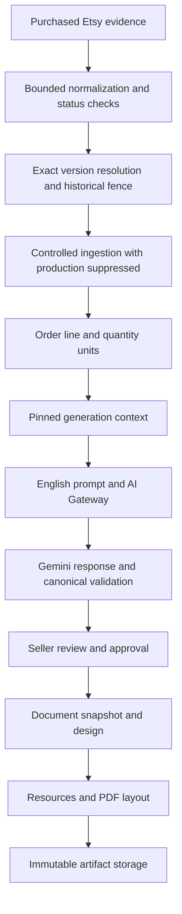

# Generation readiness audit — Part 1

Audit date: 2026-10-08. Starting HEAD: `d99a93b4eb53b4bdb1b636ca12b722f796e73961`, branch `codex/ui-ux-design-lock`. The required milestone is present at HEAD.

## Executive decision

**NO-GO for a complete real MRH reading → customer-ready PDF test.** Existing code can preserve an approved text answer and assemble a request containing the configured intimacy scope. That is materially stronger than a generic prompt, but it is not proof of a connected real-world result. There are no MRH Orders or Readings to inspect, some product/customer semantics are omitted from the prompt, the target has no usable document design, and artifact storage is not wired to a runtime implementation.

No application code, environment configuration, migrations, real domain data, or Etsy commerce state was changed. No Etsy request, token refresh, adoption, ingestion, Gemini request, PDF rendering, or artifact upload was performed. Only this report is committed. Known Next.js-generated changes in `next-env.d.ts` and `tsconfig.json` remain excluded.

## Evidence boundaries

- **R — real persisted configuration:** local PostgreSQL queries used read-only, repeatable-read transactions. The database host was verified as local. No customer answers or private source identifiers are included here.
- **T — isolated tests:** existing synthetic unit fixtures and disposable PGlite database tests; not real MRH end-to-end evidence.
- **S — source inspection:** actual runtime functions and arguments, rather than module existence.
- **P — prior acceptance:** durable earlier reports; not freshly revalidated Etsy inventory or receipt evidence.
- **U — unverified:** no live execution or rendered customer document in this audit.

A PASS below means the stated component boundary is supported by its identified evidence. It does not mean the entire live chain passed.

## Current real configuration

| Item | Persisted finding | Evidence / limitation |
|---|---|---|
| Store / connection | One MysticReadingHouse Etsy Store; connected; encrypted grant present; listing and transaction read scopes | R; present connection does not prove current API validity without a request |
| Target listing | Exact requested title, active Etsy state | R; cached listing snapshot has no description and an empty personalization collection |
| Product binding | One owned exact-selection mapping, not paused; Product active | R; canonical mapping uses stable property/value identities |
| Published version | v3 ACTIVE and referenced by Product active pointer; v1/v2 archived | R; v3 activated 2026-10-08 13:32:28.693 UTC; older version numbers must not be selected implicitly |
| Purchase configuration | Two properties, one value per property in the approved complete combination | R; no raw identities published here |
| Buyer mapping | One exact text question/property mapping to one required LONG_TEXT field | R |
| Customer field | Combined names, birth dates, relationship status and brief non-graphic context; help text empty | R; this is a definition, not a buyer answer |
| Reading structure | One section, “Sex Intimacy” | R |
| Section instruction | “Intimate energy surrounding your connection — including attraction, chemistry, hidden desires, unspoken fantasy themes, emotional restraint, intentions, and possible next moves.” | R; seller configuration, not customer content |
| Output / preparation | PDF; ASSISTED; target 60 minutes; EXPRESS priority | R; no automatic delivery authority |
| Reading media | Absent, resolved as NONE | R/S; tarot not required |
| Seller identity | No SellerProfile; Store-name fallback | R/S; no configured individual reader persona |
| Seller style | No sources or analyses; one draft style version, no active version | R; versioned platform fallback applies |
| Document design | No Store designs or Product assignment; actual resolver returns SETUP_REQUIRED | R/S |
| Domain records | Zero MRH Orders, OrderLines, fulfillment units, Generations, AI requests, queue items, reviews and artifacts | R; no real Reading context available |
| Historical state | Zero candidate review/adoption records | R; this audit records no approval |
| Migration history | 25 applied migrations | R; no migration run |

Prior real catalog acceptance in `docs/ONBOARDING_REPORT.md` records six configurations, two dimensions, one supported question, one Active and five Not configured. Current persistence still has only one target mapping. This audit did not refresh the catalog: the current six labels and their assignment to the active identity are therefore **prior/owner evidence**, not a newly verified inventory response. The database mapping retains identity, not the human-readable purchase labels. The reported Standard Delivery + Standard Detailed combination must not be relabeled from its 60-minute target: a seller may explicitly approve an urgent target for an arbitrarily named Etsy option.

## Full runtime flow

This diagram describes code boundaries. It does not depict completed real MRH execution. Historical review is not adoption; adoption is not permission to generate or deliver.

## Runtime references and buyer-context trace

| Boundary | Actual code | Data / behavior |
|---|---|---|
| Raw receipt → source | `src/modules/etsy/raw-normalizer.ts` | Bounded fields; lexical-safe int64 handling; each variation accounted for; text presence/null/value retained |
| Source → policy | `src/modules/etsy/source-contract.ts` | `etsy-purchased-line/v1`, `etsy-product-policy/v1`; canonical complete selection key; exact question/property mapping |
| Source → approved version | `src/modules/products/runtime.ts` | Owned shop/listing/complete identity set; active or explicitly adopted pinned version; historical fence; no nearest-label fallback |
| Receipt assessment / controlled command | `src/modules/etsy/controlled-intake.ts` | `assessReceiptForIntake`; `ingestControlledReceipt` suppresses production admission; line display title is currently “Etsy purchase” |
| Domain persistence | `src/modules/intake/service.ts`, `contracts.ts` | Source snapshot on line, purchased/latest receipt evidence, immutable version reference, revisioned customer inputs, stable quantity-unit indices |
| Context assembly | `src/modules/generation/context.ts` | `buildGenerationContext` / trusted production equivalent; owned records and pinned version; source/status eligibility with Etsy fulfillment policy forwarded |
| Prompt assembly | `src/modules/generation/instructions.ts` | Configured sections, customer answers, seller/style, English and exact output requirements |
| Generation admission | `src/modules/generation/service.ts` | Immutable context, command idempotency, AI request accounting, retry/lease fences and canonical validation |
| Provider | `src/infrastructure/ai/runtime.ts`, `gateway.ts`, `gemini.ts` | Explicit provider/model selection, budget reservation, bounded Google request/response |
| Review → document input | `src/modules/review/service.ts` | Approved revision required; document product name currently comes from OrderLine title |
| Document snapshot | `src/modules/documents/service.ts`, `snapshot-service.ts`, `media-service.ts` | Owned design resolution; immutable approved text/design/media provenance |
| Resources / rendering | `src/modules/documents/resources/service.ts`, `resources/fonts.ts`, `layout/engine.ts`, `pdf/service.ts` | Controlled fonts, deterministic layout, renderer with injected assets |
| Artifact / worker | `src/modules/documents/artifact-service.ts`, `src/modules/production/documents.ts` | Immutable upload/recovery and retrieval boundaries; requires injected storage ports |

### Personalization preservation

For supported text evidence, normalization preserves the original string. Bounds reject oversized evidence instead of silently truncating it. Mapping emits the answer under the seller-approved input key; intake stores it unchanged in customer-input revisions. Validation checks blank/length/type conditions without rewriting the stored text. No automatic name/date/role extraction, translation or whitespace normalization is introduced by these paths.

Context assembly reads the persisted answer and prompt assembly forwards it as customer context. **However, the prompt omits the input definition label, answer type and help text.** The key may be opaque. The answer survives, but the seller-approved explanation of what it represents does not fully reach the model.

Minimal purchaser provenance is separate: source Etsy, role PURCHASER, optional account identity. It is not a reading subject or fulfillment-recipient assignment. Controlled intake does not derive a buyer name from shipping or personalization. Purchaser provenance is stored at Order level but is not forwarded into GenerationContext. No real MRH answer exists in the domain to verify this complete chain in production data.

Missing required answers and unsupported dropdown/upload/unknown evidence fail closed. Quantity greater than one requires supported per-unit context allocation; one combined answer must not be assumed to describe multiple subjects. Source changes, version mismatch, unsafe receipt status and historical timing remain independent holds.

## Context consumption matrix

| Requested field | Classification | Actual consumption |
|---|---|---|
| Store identity | PARTIALLY CONNECTED | Ownership is enforced; Store-name seller fallback reaches context; no explicit Store identity field sent to provider |
| ProductVersion | CONNECTED | Immutable identity/configuration pinned with Generation |
| Product title | MISSING | Context product has version identity/configuration, not Product name |
| Reading scope / sections | CONNECTED | Exact configured section title/instruction reaches prompt |
| Customer-provided answer | CONNECTED | Original approved mapped value reaches prompt |
| Customer-field meaning | PARTIALLY CONNECTED | Definitions exist in context configuration but are omitted by instruction assembly |
| Exact purchased variation | PARTIALLY CONNECTED | Canonical policy identity retained for eligibility; purchased labels/evidence not sent to model |
| Requested depth | PARTIALLY CONNECTED | Only approved section/style behavior; no explicit Standard/Extra/VIP depth specification |
| Output language | CONNECTED | Pinned `en`; prompt explicitly requires English |
| Reader identity/persona | PARTIALLY CONNECTED | Store fallback; no individual approved persona assignment |
| Seller style | CONNECTED | Versioned PLATFORM_DEFAULT here; READY seller intelligence wins when available |
| Safety constraints | PARTIALLY CONNECTED | General non-guarantee/untrusted-input safeguards; no explicit product-specific adult/consent policy |
| Formatting | CONNECTED | Exact section JSON requirements; document design is a separate unresolved boundary |
| Purchaser / subject / recipient roles | PARTIALLY CONNECTED | Purchaser stored separately; subject/recipient not inferred; purchaser not sent to generation |

## Product promise and purchase depth

The owner-supplied listing promise concerns attraction, desire, hidden intimate feelings, emotional/physical chemistry, intentions and connection direction. The persisted section instruction covers much of that scope. The cached title confirms the intimacy theme. **The actual full listing description was not available in persistence and was not fetched**, so a comprehensive promise comparison remains unverified.

The configured prompt is product-specific through that section, but lacks Product title, explicit depth expectations and meaningful field definitions. One section can accommodate the requested themes; schema validity alone cannot ensure sufficient coverage or prevent generic/repetitive output. No word counts or tier differentiation are invented here.

Only one exact combination is approved. Extra/Premium and other delivery combinations cannot inherit its version. The runtime performs complete stable-identity matching; no labels, SKU, position or English delivery wording determine behavior. Preparation target and EXPRESS priority come from the approved configuration, not “Same Hour” label interpretation. Other tiers require explicit seller-approved configurations before readiness can be claimed.

Tarot: **NOT APPLICABLE**. Neither the approved media configuration nor the inspected section requires cards. Global deck/card infrastructure is not evidence that this psychic product should use tarot.

## Reader identity and style

No seller profile or named reader is configured. The actual fallback is MysticReadingHouse as Store identity, not Luna, Elara, Mira or another person. It is explicit, but not evidence of an approved individual reader persona. A controlled test should review attribution and avoid fabricated authorship.

Zero historical readings/style sources do not block generation. `src/modules/generation/defaults.ts` provides `reading-os-default-style/v1`, with structured, warm, balanced instructions. `src/modules/seller-style/analysis-generation.ts` pins applicable READY analysis when available. Generation admission pins source/version and English output; retries use that snapshot and do not adopt a later style silently. No fake seller-style record is created.

## Gemini pipeline and quality limits

Local runtime configuration selects Google and `gemini-3.5-flash-lite`; the API credential and budget configuration are present. This is configuration evidence, not model availability or a successful request. Runtime defaults and trusted override rules live in `src/infrastructure/ai/runtime.ts`; no Product-level model override was found.

The adapter uses an explicit bounded request, JSON output schema, 8,192 maximum output tokens and a 120-second timeout. It rejects redirects and oversized responses; STOP is required, token exhaustion/blocked responses do not become valid output. Gateway reservation, daily caps and usage/cost accounting include provider token evidence; ambiguous liability is not silently released.

Generation is admitted before provider dispatch with immutable context and command identity. Up to three attempts are bounded by existing retry rules; failure does not authorize blind replacement of an ambiguous request. Canonical output validation requires all exact configured section identities/titles, rejecting missing, duplicate and unknown sections. It does not prove English, factual personalization, narrative quality or advertised depth semantically. Seller review remains necessary.

The known Etsy fulfillment-policy forwarding gap is fixed in context eligibility: the pinned `etsyFulfillment` policy is supplied to source-aware triage. Sections/output/workflow/target/priority remain in the immutable approved version. Preparation policy is operational and is not itself a narrative depth instruction.

## Document / PDF readiness

The actual MRH design resolver returns SETUP_REQUIRED. PDF output selection alone does not assign a design. Existing contracts support owned versioned layouts, approved-reading snapshots, controlled resources and deterministic pagination. Fonts were loaded and their controlled package validated read-only; no PDF was rendered. Non-Latin/RTL/emoji characters outside supported fonts can fail closed even with English instructions; name glyph support must be checked in a controlled test.

A concrete metadata defect exists: controlled intake uses “Etsy purchase” as OrderLine title, and approved document assembly uses that title as product name. The target PDF would therefore not reliably use the real approved product title. Reader identity is also absent from the approved-reading/document snapshot contract.

`src/infrastructure/object-storage.ts` defines storage interfaces, but no concrete runtime storage adapter was found. Document execution requires injected `DocumentProductionPorts` assets/artifacts; no production-ready default wiring was found. Immutable artifact persistence/recovery and owned retrieval exist as services, but an actual authenticated download route was not found. Storage configuration cannot be declared ready based on test adapters.

No real document snapshot, resources resolution, render, upload or download was attempted. Customer-ready PDF readiness is therefore blocked, even though the underlying renderer foundation exists.

## Workflow and fulfillment safety

ASSISTED permits automatic preparation admission; MANUAL does not enter generation solely because its target is urgent. Priority orders work under contention; a 60-minute target does not introduce a 60-minute processing delay. Queue claiming/recovery is internal and fenced; no live MRH queue execution was performed.

Controlled Etsy ingestion explicitly suppresses production admission. Generic intake may create waiting work under approved policy, but that is not a provider call. Generation success does not deliver. Review approval is required before document snapshot admission; PDF creation does not message Etsy. No automatic buyer delivery connection was found. Historical adoption overrides only its approved timing fence, not source, payment, input, quantity or review protections.

## Developer surfaces and security

Historical review is owner- and Store-authorized, and its actions bind fresh evidence to the exact source/version/reviewing owner. It does not expose answers, credentials or raw payloads in its candidate projection. Cross-tenant authorization is a substantive boundary.

**Developer-only isolation is not satisfied:** `/etsy/historical-review` is included in the production build and has no development/internal-capability gate. An authenticated Store owner can invoke it for their own Store. Authentication and hidden navigation do not make it developer-only. This is not evidence of anonymous or cross-tenant access, but conflicts with the stated requirement that internal tooling be unavailable to customers. Gate both route and actions if it remains an internal tool.

Development credentials, fixture connections and fake-provider selection have production guards in the inspected paths. No additional mock/debug payload API was found. Encrypted grants remain server-owned. Private context retention/logging requirements remain subject to existing pilot debt; no sensitive values were logged by this audit.

## Readiness matrix

| Component | Status | Evidence | Blocker / required action |
|---|---|---|---|
| Etsy source identity | PASS | R/P/S/T | Canonical identities present; fresh receipt validity still required before intake |
| ProductVersion resolution | PASS | R/S/T | Exact active v3 binding; never substitute another version |
| Purchase combination eligibility | PASS | R/S/T | Only exact approved combination; refresh catalog before asserting current labels/counts |
| Buyer input preservation | PARTIAL | S/T; no real Reading | Verify one authorized real answer end-to-end privately |
| Generation context assembly | PARTIAL | S/T | Add approved product title and customer-field semantics to existing context/prompt |
| Product-specific prompt | PARTIAL | R/S | Intimacy instruction present; missing title/field meaning/depth specificity |
| Reader identity | PARTIAL | R/S | Explicit Store fallback; owner must approve attribution/persona expectations |
| Style resolution | PASS | R/S/T | Versioned platform fallback available; no history required |
| Reading depth | PARTIAL | R/S | No explicit approved tier differentiation; other combinations remain held |
| Gemini dispatch readiness | PARTIAL | Environment/S/T | No live request; source/context authorization and content-safety review required |
| Output schema | PASS | S/T | Exact canonical configured section structure |
| Validation / content quality | PARTIAL | S/T | Structural checks do not prove narrative quality or personalization |
| Queue orchestration | PASS | S/T | Internal fenced execution; no real queue admission in audit |
| PDF design | FAIL | R/S | Actual SETUP_REQUIRED; assign an approved existing design |
| PDF resources | PASS | Read-only font verification/S | Verify actual generated glyph coverage later; cards unnecessary |
| PDF rendering for target | NOT VERIFIED | U | No target snapshot/design/render attempted |
| Artifact storage / download | FAIL | S | Implement/wire trusted existing ports and owned retrieval surface |
| Review / approval | PASS | S/T | Approved revision gates document input; no real review yet |
| Delivery isolation | PASS | S/T | No automatic Etsy messaging/delivery path invoked |
| Developer-route isolation | FAIL | S/build | Historical review exposed to authenticated customer owners; internal gate needed |
| PDF product/reader metadata | FAIL | S | Generic line title reaches document; approved attribution absent |
| Real Order → Generation handoff | NOT VERIFIED | R/U | Zero MRH Orders/Readings; explicit controlled intake prerequisite |
| Full listing-promise comparison | NOT VERIFIED | R/P/U | Description not cached; private owner comparison needed |
| Tarot/card pipeline | NOT APPLICABLE | R/S | Product does not require tarot |
| Etsy policy forwarding | PASS | S/T | Pinned policy passed into generation eligibility |

Totals: **10 PASS, 7 PARTIAL, 4 FAIL, 3 NOT VERIFIED, 1 NOT APPLICABLE**.

## Explicit answers and minimal next milestone

1. **Can the active combination be ingested without losing product/buyer context?** Exact source, version, purchaser provenance and complete mapped text can be preserved by existing contracts, subject to status/timing/quantity gates. Full downstream context is incomplete: display title and field meaning are dropped. No real persisted Reading proves the chain yet.
2. **Can it produce a product-specific Gemini request?** Conditionally yes: the actual intimacy section instruction is included. It is PARTIAL, not a verified real request, because title, field semantics and explicit depth expectations are absent.
3. **Will exact depth and scope be reflected?** Scope is instructed; depth quality is not guaranteed. No runtime proof of Standard/Extra/VIP differentiation exists. Other combinations are held instead of receiving Standard output.
4. **Can output become a complete customer-ready PDF now?** No: unresolved design, missing storage runtime wiring and incorrect/generic product metadata block that claim.
5. **Can testing avoid contacting the Etsy buyer?** Yes. Private controlled ingestion, explicit provider testing, manual review and local artifact validation need no Etsy messaging or fulfillment. Sending private context to Google still requires the separately authorized controlled test.
6. **Smallest changes before the first complete test:** preserve approved product title and input-definition meaning in existing pinned generation contracts/prompt; correct document metadata; configure an existing approved design; wire trusted storage/retrieval ports. Obtain exact-source owner approval and an eligible Reading through existing controlled intake. Review actual product scope/attribution and adult-content constraints privately. No new Product, tier, parsing, style or queue architecture is needed.
7. **Blocking versus deferred:** real Reading/authorization and trustworthy context are prerequisites for a paid Gemini test; design/storage/metadata block full PDF acceptance. Developer isolation blocks customer-facing internal-tool release. Other five combinations, optional seller styles, named persona enhancements, bulk setup, automatic person extraction and delivery may remain deferred with honest holds/no delivery claims. Do not invent required tarot or output word counts.

The next implementation should be a bounded **generation/document context connection and runtime PDF readiness** milestone, followed by separately authorized single-purchase intake and one controlled generation attempt. This audit authorizes neither.

## First controlled test plan

1. Privately refresh and review one exact purchased transaction and the intended immutable version. Resolve historical approval only through explicit owner confirmation; reject source drift and unrelated lines.
2. Invoke existing controlled intake with production suppressed under separate authorization. Verify source, purchaser, complete unchanged answer, unit count and version through structural assertions.
3. Build a side-effect-free generation context; verify approved title, section scope, field meaning, English, style provenance and exact policy. Log no answer values. Review content suitability and attribution privately.
4. Authorize one bounded paid Gemini request, with known budget/model and no automatic ambiguous retry. Inspect canonical output and product-specific quality; do not contact the buyer.
5. Obtain explicit seller review/approval. Resolve the configured design/resources, render and persist privately through trusted storage, verify immutable artifact and authorized download. No Etsy messages or delivery.
6. Record actual evidence separately from fixture tests. Keep `ETSY-E2E-01`, `ETSY-CARDINALITY-01` and `ETSY-INPUTS-01` OPEN until their own criteria are met.

## Validation and repository outcome

- 148 existing unit tests across 11 relevant files passed: generation, defaults, Etsy normalization/source, document design/layout/snapshot, review, production boundaries, session guards and candidate review UI.
- 119 isolated database tests across generation, controlled Etsy intake and document snapshot suites passed. These use disposable synthetic data; no MRH database records were created.
- `pnpm typecheck`: PASS.
- Production build: PASS, including the historical review route (relevant to the isolation finding).
- Controlled font package load/hash validation: PASS; no PDF rendered.
- `git diff --check`: PASS before documentation commit.
- No migrations, provider requests, real source reads, domain writes or artifact uploads performed.
- Existing generated tooling diffs were inspected and preserved outside the commit.

**Final decision: NO-GO for executing the complete real end-to-end generation/PDF test now.** The underlying generation foundation is viable; implementation, explicit owner authorization and real evidence are still required at the identified boundaries.
