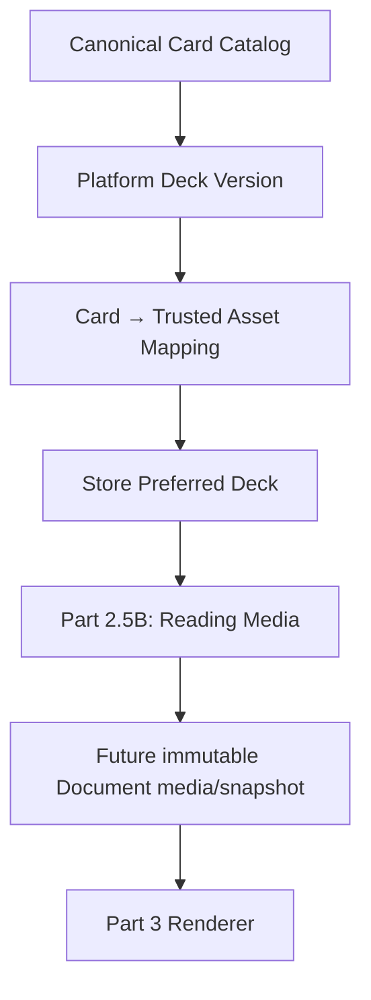

# Reading media foundation — Part 2.5A

PART 2.5A DOES NOT ADD TAROT CARDS TO GENERATED READINGS.

PART 2.5A DOES NOT MODIFY DOCUMENT SNAPSHOT SEMANTICS.

PART 2.5A DOES NOT RENDER A PDF.

## Domain ownership and pipeline

`src/modules/media` is independent of Generation, Review, seller Style, Product configuration and Document Design/Snapshot JSON. No module imports Reading body, customer inputs, AI gateway/provider/accounting or billing. Seller services authorize persisted membership/Store ownership. Platform registry administration is a separate trusted offline server composition, with no seller HTTP action, API route, UI or Scope-based mutation capability. Possession of an application Database handle is trusted server access, never a client credential. A future platform admin entry point must establish operator authorization before constructing `platformMediaRegistry`; this milestone creates no admin authentication or endpoint.

The final three nodes are deferred. A Store preference is mutable future policy, never immutable historical evidence.

## Canonical identities and orientation

`catalog.ts` owns a frozen code catalog of exactly **78** card identities. Display labels are metadata, never identities. Major Arcana keys are explicit: THE_FOOL, THE_MAGICIAN, THE_HIGH_PRIESTESS, THE_EMPRESS, THE_EMPEROR, THE_HIEROPHANT, THE_LOVERS, THE_CHARIOT, STRENGTH, THE_HERMIT, WHEEL_OF_FORTUNE, JUSTICE, THE_HANGED_MAN, DEATH, TEMPERANCE, THE_DEVIL, THE_TOWER, THE_STAR, THE_MOON, THE_SUN, JUDGEMENT, THE_WORLD. JUDGEMENT is the canonical spelling; there are no implicit aliases.

Deterministic order is zero-based Major Arcana 0–21 (Strength 8, Justice 11), followed by WANDS, CUPS, SWORDS, PENTACLES. Each suit uses ACE, TWO, THREE, FOUR, FIVE, SIX, SEVEN, EIGHT, NINE, TEN, PAGE, KNIGHT, QUEEN, KING. Minor keys use `<RANK>_OF_<SUIT>`. Catalog validation checks the complete tuple of key, arcana, suit/rank (null for majors), order and stable label. `getCanonicalCard` accepts only a supported key. Catalog changes require explicit compatible evolution; retain historical identities/order.

Semantic orientation vocabulary is exactly UPRIGHT and REVERSED. It belongs to future Reading Media, never to artwork or deck mappings. No orientations or cards are assigned to Readings here.

## Durable platform assets and storage

`platform_assets` has an immutable UUID identity, a unique internal object key, and a strict bounded metadata value: TAROT_CARD_IMAGE kind; image/png, image/jpeg or image/webp MIME; 1–25 MiB positive integral byte size; lowercase hexadecimal SHA-256 digest; positive integral dimensions up to 16384 per side and at most 100 million pixels; broad 1:10–10:1 sanity bounds (no fixed portrait ratio); READY or UNAVAILABLE lifecycle; controlled rights/provenance; creation timestamp. Only READY/APPROVED assets resolve as usable. Metadata is limited to 8 KiB in SQL. Other asset kinds such as logos/covers are deferred; the independent asset domain can add controlled kinds later.

Authoritative object keys are bounded to 512 characters and the `platform/` namespace with a raster extension and a narrow ASCII allowlist. URLs, data URLs, SVG, HTML, path traversal and double slashes are rejected. Neither URLs nor credentials are returned to seller catalog or card-resolution consumers. Metadata is not a claim that binary decoding was performed: no upload/import/decoder is implemented. Future controlled ingestion must verify decoded format/dimensions and approved provenance before registration.

The existing `src/infrastructure/object-storage.ts` remains the single storage-port location. Its `PrivateObjectStorage` is tenant-scoped and unimplemented. The adjacent `PlatformAssetStorage.read({objectKey})` is the narrow read-only platform namespace port for the same intended S3-compatible backend, without inventing a fake tenant. There is no AWS SDK, production cloud adapter, upload, presigning, CDN or network-dependent test.

`readPlatformAssetBytes` is trusted server composition only. It accepts a strict asset identity command, re-reads and validates the durable asset, derives the internal key, invokes an injected trusted storage adapter, checks byte length and SHA-256, and returns a detached binary copy. It accepts no caller hash/key/URL. A missing/forged identity or wrong bytes fails closed. Metadata contracts are recursively frozen; binary Uint8Array output is copied, as JavaScript cannot freeze a populated typed array. No storage keys or binary retrieval are wired to sellers.

SHA-256 content hash and UUID identity are separate. SQL rejects every asset update/delete, including rights, timestamps and object-key changes. Replacement requires a new UUID **and a new object key**; even identical bytes may have separate identities. Future storage adapters must preserve write-once historical objects; they must not overwrite old keys. Unexpected overwritten storage bytes fail integrity checks rather than becoming a different image under the same identity. Asset revocation/rights amendment needs a deliberately designed later lifecycle; this milestone permits no silent mutation or deletion of retained assets.

## Platform decks and immutable versions

Four additive tables are used. `tarot_decks` owns stable key, display name and optional-in-meaning bounded description. Its identity/display metadata is immutable; rendering-critical history belongs to versions/assets. Names are 1–100 trimmed plain characters, descriptions at most 300, keys lowercase ASCII slugs up to 64. There is no deck-count maximum.

`tarot_deck_versions` owns a composite deck key/positive integer version, DRAFT/PUBLISHED/RETIRED status and an atomic bounded JSON manifest containing exact mappings, rights/provenance, mappingHash and creation time. The manifest holds `{cardKey, assetId}` entries. A separate mapping table would add mutable relationship lifecycle and publication coordination without a current independent mapping-write need; one manifest freezes the entire mapping atomically. No deck version or platform asset has tenant fields. Asset references within the JSON are validated by application boundaries and SQL publication/retention guards rather than JSON foreign keys. Asset deletion is globally forbidden.

DRAFT is a non-usable offline staging state, not a seller feature. The operator runtime publishes a complete new manifest directly; SQL also supports controlled staged publication. Published/retired manifest semantics are immutable: only PUBLISHED → RETIRED is allowed, including matching manifest status. RETIRED is terminal, cannot be fabricated directly and cannot be reactivated. SQL forbids version deletion. Artwork or mapping changes require another positive version. At most one PUBLISHED version per deck is enforced with a partial unique index; retire the old version and publish the next explicitly. There is no floating latest-version resolution or automatic preference migration.

Publication and every usable read validate all 78 mappings: exactly one per canonical key, no missing/unknown/duplicate keys, valid referenced asset identity, strict valid metadata, appropriate raster image kind/MIME, READY lifecycle and APPROVED rights. 77/79 cards fail closed. Sharing one asset across different keys is not prohibited (synthetic tests do this); completeness is about semantic keys, not arbitrary uniqueness of image bytes. `mappingHash` is SHA-256 of existing stable JSON serialization of the exact mapping array. Application reads verify this hash; SQL supplements validation with canonical completeness, asset existence/usability, lifecycle, bounds and immutability. SQL does not substitute for strict Zod or digest verification.

## Controlled rights and provenance

Assets and deck versions independently carry UNVERIFIED/APPROVED/RESTRICTED rights state; UNVERIFIED/PLATFORM_ORIGINAL/LICENSED/PUBLIC_DOMAIN classification; a bounded source label; nullable bounded evidence-reference identifier; bounded internal notes. APPROVED requires a non-UNVERIFIED classification and nonempty evidence reference. Approval is a controlled operator decision; validation cannot prove a legal license exists. Both asset and deck rights must be APPROVED before publication/selection/resolution. Seller metadata excludes evidence, notes, source and classification. No artwork, licenses or public-domain claims are fabricated. Tests use explicitly synthetic fixtures; no actual imagery is downloaded, seeded or imported.

## Narrow reads

- `resolveTarotCardAsset({deckKey, deckVersion, cardKey})`: exact historical version; validated detached deeply frozen `tarot-card-asset/v1`, containing the exact deck/version/card and only asset UUID, digest, MIME, byte size and dimensions. No raw rows, object keys, credentials, cloud URLs, orientation or provenance internals.
- `listSelectableTarotDecks(db, scope)`: authenticated Store scope; only stable key, display name, exact currently PUBLISHED version and short description. No database IDs, internal lifecycle or storage/legal details. Corruption in a claimed-selectable entry fails the read instead of silently omitting it.
- `getStorePreferredTarotDeck(db, scope)`: immutable validated preference contract or NOT_CONFIGURED/revision 0. No default is seeded or inferred from catalog order.

Multi-query catalog/card/preference reads use repeatable-read transactions. Every mapped asset is validated even if only one card is requested. Unknown decks/versions, malformed enums/keys, missing assets, identity mismatch, invalid metadata, rights errors, mapping corruption or invalid preference references produce MEDIA_UNAVAILABLE (or strict command validation failure). Reads do not repair, substitute, mutate or default.

## Store preference, retirement and concurrency

`store_tarot_preferences` is uniquely owned by organization/Store with a composite Store FK, exact deck/version FK and positive monotonic revision. The command accepts only deck key, version and expectedRevision. Store and organization derive from verified authenticated scope; supplied ownership/platform mutation fields are rejected. Writes require owner membership and the established Store row lock. Reads use persisted membership checks. Sibling Stores have separate preferences and cannot target another preference through client fields.

Absent preference has revision 0. First selection creates revision 1; changes increment exactly once. Identical commands at the current revision are no-ops; stale commands conflict. Existing structural corruption blocks replacement. A valid retired preference can be explicitly replaced with an approved currently selectable version, using its last known revision. Its read fails safely with MEDIA_UNAVAILABLE until replacement; no automatic fallback/migration is performed. Retirement does not rewrite existing preferences, and they can retain a formerly valid reference without remaining usable for new resolution.

Selection locks the exact target version FOR SHARE, retained to commit, and revalidates completeness and rights in the transaction. Retirement takes FOR UPDATE on that version. SQL preference guards also lock the Store then version and verify selectable state, preventing a registry status change from invalidating a selection at commit. Concurrent preference updates serialize on Store and conflict by revision. Publication serializes on the platform deck; a selection either sees an approved published complete manifest or fails. No distributed lock, retry loop or external operation is used. A preference may become unavailable **after** its valid commit when retirement commits later; historical pinned card resolution remains available.

PGlite tests exercise overlapping promises and both durable relationship outcomes. Native PostgreSQL multi-connection lock timing remains a verification limitation here: sandboxed initdb failed with shared-memory permission denial. PGlite is not evidence of native parallel lock scheduling.

## Extensions deliberately deferred

Future Product override can reference the same exact platform deck/version in a separate owned Product preference table and resolve Product override → Store preference. It need not change canonical cards, assets or deck semantics. No Product assignment exists here.

Future entitlement authorization can ask whether this Store may use DOCUMENT_TAROT_CARD_IMAGES (conceptual capability), independent of named plans or standard/custom subscription offers. No billing, price, plan, entitlement table or authorization hook is implemented now.

Part 2.5B owns semantic card/orientation attachment to Reading Media, exact deck/version pinning and the deliberate choice of separate immutable media boundary versus document-snapshot/v2. Existing approved-reading/v1 and document-snapshot/v1 remain byte-for-byte unchanged here. Store preference never enters current snapshot hashes.

Part 3 owns trusted byte use, image decoding/layout/fit, reversed transforms, pagination, preview/PDF embedding and renderer version behavior. No renderer, card placement, download, artifact, delivery, Etsy message or Telegram capability is added.
