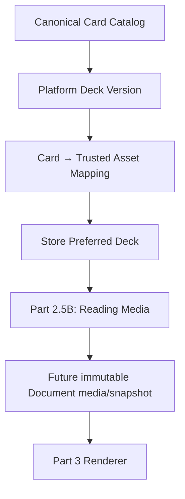

# Reading media — Parts 2.5A–2.5B

PART 2.5A DOES NOT ADD TAROT CARDS TO GENERATED READINGS.

PART 2.5A DOES NOT MODIFY DOCUMENT SNAPSHOT SEMANTICS.

PART 2.5A DOES NOT RENDER A PDF.

## Domain ownership and pipeline

`src/modules/media` is independent of Generation, Review, seller Style, Product configuration and Document Design/Snapshot JSON. No module imports Reading body, customer inputs, AI gateway/provider/accounting or billing. Seller services authorize persisted membership/Store ownership. Platform registry administration is a separate trusted offline server composition, with no seller HTTP action, API route, UI or Scope-based mutation capability. Possession of an application Database handle is trusted server access, never a client credential. A future platform admin entry point must establish operator authorization before constructing `platformMediaRegistry`; this milestone creates no admin authentication or endpoint.

The final three nodes are deferred. A Store preference is mutable future policy, never immutable historical evidence.

## Canonical identities and orientation

`catalog.ts` owns a frozen code catalog of exactly **78** card identities. Display labels are metadata, never identities. Major Arcana keys are explicit: THE_FOOL, THE_MAGICIAN, THE_HIGH_PRIESTESS, THE_EMPRESS, THE_EMPEROR, THE_HIEROPHANT, THE_LOVERS, THE_CHARIOT, STRENGTH, THE_HERMIT, WHEEL_OF_FORTUNE, JUSTICE, THE_HANGED_MAN, DEATH, TEMPERANCE, THE_DEVIL, THE_TOWER, THE_STAR, THE_MOON, THE_SUN, JUDGEMENT, THE_WORLD. JUDGEMENT is the canonical spelling; there are no implicit aliases.

Deterministic order is zero-based Major Arcana 0–21 (Strength 8, Justice 11), followed by WANDS, CUPS, SWORDS, PENTACLES. Each suit uses ACE, TWO, THREE, FOUR, FIVE, SIX, SEVEN, EIGHT, NINE, TEN, PAGE, KNIGHT, QUEEN, KING. Minor keys use `<RANK>_OF_<SUIT>`. Catalog validation checks the complete tuple of key, arcana, suit/rank (null for majors), order and stable label. `getCanonicalCard` accepts only a supported key. Catalog changes require explicit compatible evolution; retain historical identities/order.

Semantic orientation vocabulary is exactly UPRIGHT and REVERSED. It belongs to future Reading Media, never to artwork or deck mappings. No orientations or cards are assigned to Readings here.

## Durable platform assets and storage

`platform_assets` has an immutable UUID identity, a unique internal object key, and a strict bounded metadata value: TAROT_CARD_IMAGE kind; image/png, image/jpeg or image/webp MIME; 1–25 MiB positive integral byte size; lowercase hexadecimal SHA-256 digest; positive integral dimensions up to 16384 per side and at most 100 million pixels; broad 1:10–10:1 sanity bounds (no fixed portrait ratio); READY or UNAVAILABLE lifecycle; controlled rights/provenance; creation timestamp. Only READY/APPROVED assets resolve as usable. Metadata is limited to 8 KiB in SQL. Other asset kinds such as logos/covers are deferred; the independent asset domain can add controlled kinds later.

Authoritative object keys are bounded to 512 characters and the `platform/` namespace with a raster extension and a narrow ASCII allowlist. URLs, data URLs, SVG, HTML, path traversal and double slashes are rejected. Neither URLs nor credentials are returned to seller catalog or card-resolution consumers. Metadata is not a claim that binary decoding was performed: no upload/import/decoder is implemented. Future controlled ingestion must verify decoded format/dimensions and approved provenance before registration.

The existing `src/infrastructure/object-storage.ts` remains the single storage-port location. Its `PrivateObjectStorage` is tenant-scoped and unimplemented. The adjacent `PlatformAssetStorage.read({objectKey})` is the narrow read-only platform namespace port for the same intended S3-compatible backend, without inventing a fake tenant. There is no AWS SDK, production cloud adapter, upload, presigning, CDN or network-dependent test.

`readPlatformAssetBytes` is trusted server composition only. It accepts a strict asset identity command, re-reads and validates the durable asset, derives the internal key, invokes an injected trusted storage adapter, checks byte length and SHA-256, and returns a detached binary copy. It accepts no caller hash/key/URL. A missing/forged identity or wrong bytes fails closed. Metadata contracts are recursively frozen; binary Uint8Array output is copied, as JavaScript cannot freeze a populated typed array. No storage keys or binary retrieval are wired to sellers.

SHA-256 content hash and UUID identity are separate. SQL rejects every asset update/delete, including rights, timestamps and object-key changes. Replacement requires a new UUID **and a new object key**; even identical bytes may have separate identities. Future storage adapters must preserve write-once historical objects; they must not overwrite old keys. Unexpected overwritten storage bytes fail integrity checks rather than becoming a different image under the same identity. Asset revocation/rights amendment needs a deliberately designed later lifecycle; this milestone permits no silent mutation or deletion of retained assets.

## Platform decks and immutable versions

Four additive tables are used. `tarot_decks` owns stable key, display name and optional-in-meaning bounded description. Its identity/display metadata is immutable; rendering-critical history belongs to versions/assets. Names are 1–100 trimmed plain characters, descriptions at most 300, keys lowercase ASCII slugs up to 64. There is no deck-count maximum.

`tarot_deck_versions` owns a composite deck key/positive integer version, DRAFT/PUBLISHED/RETIRED status and an atomic bounded JSON manifest containing exact mappings, rights/provenance, mappingHash and creation time. The manifest holds `{cardKey, assetId}` entries. A separate mapping table would add mutable relationship lifecycle and publication coordination without a current independent mapping-write need; one manifest freezes the entire mapping atomically. No deck version or platform asset has tenant fields. Asset references within the JSON are validated by application boundaries and SQL publication/retention guards rather than JSON foreign keys. Asset deletion is globally forbidden.

DRAFT is a non-usable offline staging state, not a seller feature. The operator runtime publishes a complete new manifest directly; SQL also supports controlled staged publication. Published/retired manifest semantics are immutable: only PUBLISHED → RETIRED is allowed, including matching manifest status. RETIRED is terminal, cannot be fabricated directly and cannot be reactivated. SQL forbids version deletion. Artwork or mapping changes require another positive version. At most one PUBLISHED version per deck is enforced with a partial unique index; retire the old version and publish the next explicitly. There is no floating latest-version resolution or automatic preference migration.

Publication and every usable read validate all 78 mappings: exactly one per canonical key, no missing/unknown/duplicate keys, valid referenced asset identity, strict valid metadata, appropriate raster image kind/MIME, READY lifecycle and APPROVED rights. 77/79 cards fail closed. Sharing one asset across different keys is not prohibited (synthetic tests do this); completeness is about semantic keys, not arbitrary uniqueness of image bytes. `mappingHash` is SHA-256 of existing stable JSON serialization of the exact mapping array. Application reads verify this hash; SQL supplements validation with canonical completeness, asset existence/usability, lifecycle, bounds and immutability. SQL does not substitute for strict Zod or digest verification.

## Controlled rights and provenance

Assets and deck versions independently carry UNVERIFIED/APPROVED/RESTRICTED rights state; UNVERIFIED/PLATFORM_ORIGINAL/LICENSED/PUBLIC_DOMAIN classification; a bounded source label; nullable bounded evidence-reference identifier; bounded internal notes. APPROVED requires a non-UNVERIFIED classification and nonempty evidence reference. Approval is a controlled operator decision; validation cannot prove a legal license exists. Both asset and deck rights must be APPROVED before publication/selection/resolution. Seller metadata excludes evidence, notes, source and classification. No artwork, licenses or public-domain claims are fabricated. Tests use explicitly synthetic fixtures; no actual imagery is downloaded, seeded or imported.

## Narrow reads

- `resolveTarotCardAsset({deckKey, deckVersion, cardKey})`: exact historical version; validated detached deeply frozen `tarot-card-asset/v1`, containing the exact deck/version/card and only asset UUID, digest, MIME, byte size and dimensions. No raw rows, object keys, credentials, cloud URLs, orientation or provenance internals.
- `listSelectableTarotDecks(db, scope)`: authenticated Store scope; only stable key, display name, exact currently PUBLISHED version and short description. No database IDs, internal lifecycle or storage/legal details. Corruption in a claimed-selectable entry fails the read instead of silently omitting it.
- `getStorePreferredTarotDeck(db, scope)`: immutable validated preference contract or NOT_CONFIGURED/revision 0. No default is seeded or inferred from catalog order.

Multi-query catalog/card/preference reads use repeatable-read transactions. Every mapped asset is validated even if only one card is requested. Unknown decks/versions, malformed enums/keys, missing assets, identity mismatch, invalid metadata, rights errors, mapping corruption or invalid preference references produce MEDIA_UNAVAILABLE (or strict command validation failure). Reads do not repair, substitute, mutate or default.

## Store preference, retirement and concurrency

`store_tarot_preferences` is uniquely owned by organization/Store with a composite Store FK, exact deck/version FK and positive monotonic revision. The command accepts only deck key, version and expectedRevision. Store and organization derive from verified authenticated scope; supplied ownership/platform mutation fields are rejected. Writes require owner membership and the established Store row lock. Reads use persisted membership checks. Sibling Stores have separate preferences and cannot target another preference through client fields.

Absent preference has revision 0. First selection creates revision 1; changes increment exactly once. Identical commands at the current revision are no-ops; stale commands conflict. Existing structural corruption blocks replacement. A valid retired preference can be explicitly replaced with an approved currently selectable version, using its last known revision. Its read fails safely with MEDIA_UNAVAILABLE until replacement; no automatic fallback/migration is performed. Retirement does not rewrite existing preferences, and they can retain a formerly valid reference without remaining usable for new resolution.

Selection locks the exact target version FOR SHARE, retained to commit, and revalidates completeness and rights in the transaction. Retirement takes FOR UPDATE on that version. SQL preference guards also lock the Store then version and verify selectable state, preventing a registry status change from invalidating a selection at commit. Concurrent preference updates serialize on Store and conflict by revision. Publication serializes on the platform deck; a selection either sees an approved published complete manifest or fails. No distributed lock, retry loop or external operation is used. A preference may become unavailable **after** its valid commit when retirement commits later; historical pinned card resolution remains available.

PGlite tests exercise overlapping promises and both durable relationship outcomes. Native PostgreSQL multi-connection lock timing remains a verification limitation here: sandboxed initdb failed with shared-memory permission denial. PGlite is not evidence of native parallel lock scheduling.

## Extensions deliberately deferred

Future Product override can reference the same exact platform deck/version in a separate owned Product preference table and resolve Product override → Store preference. It need not change canonical cards, assets or deck semantics. No Product assignment exists here.

Future entitlement authorization can ask whether this Store may use DOCUMENT_TAROT_CARD_IMAGES (conceptual capability), independent of named plans or standard/custom subscription offers. No billing, price, plan, entitlement table or authorization hook is implemented now.

Part 2.5B owns semantic card/orientation attachment to Reading Media, exact deck/version pinning and the deliberate choice of separate immutable media boundary versus document-snapshot/v2. Existing approved-reading/v1 and document-snapshot/v1 remain byte-for-byte unchanged here. Store preference never enters current snapshot hashes.

Part 3 owns trusted byte use, image decoding/layout/fit, reversed transforms, pagination, preview/PDF embedding and renderer version behavior. No renderer, card placement, download, artifact, delivery, Etsy message or Telegram capability is added.

## Part 2.5B — semantic Reading Media and immutable Document input

Part 2.5B connects the existing platform foundation to Generation → Review approval → immutable Document input. No real artwork, renderer, PDF, billing or final frontend is introduced. The Part 2.5A statements above describe that foundation's historical scope; Part 2.5B now adds semantic cards to explicitly configured generated Readings.

### Version-owned Product requirements and historical compatibility

ProductVersion configuration accepts optional strict `readingMedia: {mode: "NONE"} | {mode: "TAROT_CARDS", cardCount: 1..10}`. Absence means historical NONE **at the interpretation boundary**, without adding defaults to parsed/stored JSON or modifying published versions. Explicit NONE produces the same text output/prompt path. Unsupported modes, extra fields and malformed counts are rejected. No Product-specific deck override or media configuration UI is added.

GenerationContext already freezes exact ProductVersion configuration and stable JSON hash. The optional requirement lives inside that frozen config; no second floating requirement or duplicate context field exists. Admission uses the bound published/archived version. Retry/replay retains the admitted context/config/hash, not the latest ProductVersion. A later 3→5-card version does not rebind an existing Reading.

### Provider-neutral semantic output

Text-only canonical results remain `{sections}`. Required tarot results are `{sections, readingMedia: {mode: "TAROT_CARDS", cards: [{cardKey, orientation, position}]}}`. Count must exactly match the frozen requirement. Identities must be canonical, distinct within a draw; orientations are UPRIGHT/REVERSED. Positions are zero-based, consecutive and equal array order. There are no section associations in this first contract; extra sectionId fields are rejected rather than inventing card-to-section semantics. Unknown fields, deck/version/asset/key/URL/MIME/dimensions and malformed/missing media fail canonical validation. No repair or silent card regeneration occurs.

The existing GenerationService → CentralAIGateway → GenerationProvider path is retained. Tarot requests use the existing provider-neutral structuredOutput property with a manually projected bounded canonical enum schema (`canonical-reading-media/v1`); Gemini's existing generic OpenAPI projection handles it, without a tarot-specific provider. The prompt supplies exactly the required count and deterministic 78-key vocabulary, asks for consistent written interpretation and cards, and never includes deck preference, artwork, images, assets/storage/legal data. NONE retains the existing provider schema path. The fake provider deterministically chooses the first required canonical keys and alternating orientations, with no randomness.

Input reservation counts prompt bytes plus the additional tarot structured-output schema bytes; existing schema-envelope allowance/output limit, budgets, attempts, unknown-cost policy and usage/cost settlement remain intact. Invalid card output settles as existing INVALID_OUTPUT; safe retry uses admitted requirements. Failed attempts do not preserve a draw. The successful canonical result is the evidence.

### Review, body editing and approval

The immutable Review Generation pin pins the exact successful semantic cards. `openReadingReview` exposes detached frozen readingMedia alongside the existing body workspace; a later Generation does not replace it. Existing draft content remains sections only. Application and SQL reject card fields in draft writes; section-body edits do not alter card identity/orientation/positions.

Approval atomically freezes sections and separately `reading_reviews.approved_media`, containing `approved-reading-media/v1`: owned Reading identity, pinned Review/Generation provenance, exact requirement, semantic media, mediaHash and approval timestamp. Required missing/corrupt cards fail before approval. The SQL approval guard binds the media artifact to the pinned successful result and its frozen context requirement, retaining immutable approval and draft transitions.

The existing approved-reading/v1 schema and sections-only contentHash remain unchanged. `getApprovedReadingMedia` and its transaction variant are the separate Review-approved handoff; Documents never discover semantic cards by reaching into raw Generation JSON. Reads validate the artifact/hash/provenance against the Review pin within Review ownership. Historical approved text-only rows with NULL approved_media expose faithful NONE semantics without backfill; required tarot rows with NULL media fail. No old approval, Generation result or Product JSON is migrated to fabricate cards.

### Document architecture decision: separate media, preserved v1

Chosen: **separate immutable `document-media-snapshot/v1`**, paired with the exact existing document-snapshot/v1 via `document-render-input/v1`. Rejected for this slice: snapshot v2 would repeat/re-version already correct text/design semantics and require parallel validation paths for unchanged content. The small independent media boundary preserves all historical v1 schemas/hashes while giving Part 3 one exact combined input. A later incompatible text/design evolution may still introduce its own version deliberately.

`createDocumentRenderInput(db, scope, {orderId, readingId})` is the new complete-input command. It verifies owner scope and creates/reuses text/design snapshot and media in **one Store-locked transaction**. Transaction-composable snapshot helpers are a non-semantic refactor of the v1 service; original APIs remain text/design v1 boundaries. Required cards always resolve/freeze regardless of the design's cardImagery display boolean: semantic presence and presentation are independent. Existing design schema/settings are unchanged.

For TAROT_CARDS, the command obtains the current valid server-side Store preference, locks the exact selectable deck version FOR SHARE through commit, and resolves every approved card through the existing trusted registry boundary. Missing preference throws DOCUMENT_MEDIA_SETUP_REQUIRED; retired/corrupt/unusable preference fails safely. No catalog-first fallback, caller-selected deck/asset or implicit Product override exists. NONE requires no deck.

The immutable media snapshot freezes its own identity/ownership, parent snapshot identity, Reading identity, Review/Generation and approved-media-hash provenance, exact media mode, deck key/version, and ordered semantic cardKey/orientation/position plus asset UUID/SHA-256/MIME/dimensions/byte size. No object keys, URLs, credentials, legal notes, body/customer content or AI/provider details enter it. Binary bytes are not embedded. Part 3 will read exact asset identity through PlatformAssetStorage and verify bytes before rendering.

`getDocumentRenderInput` accepts one owned media snapshot identity and returns validated detached deeply frozen text/design/media plus combined hash. It reads retained approval/snapshot identity and exact historical deck/asset evidence only; no current Store preference, design config/default/assignment, draft, customer context, latest ProductVersion/Style or Generation body/card lookup supplies renderer input. Frozen assets are compared to the exact retained deck mapping/metadata; retired versions remain historically valid. New registry additions/versions/preferences, design changes and later Generations do not change the returned input. Older bare v1 snapshots remain readable through their unchanged reader; no media row is fabricated for them.

### Independent hash meanings

- Existing approved contentHash: SHA-256 stable JSON `{sections}` only, including exact final body/order/identities/titles.
- Existing design configurationHash and snapshotHash: unchanged v1 semantics.
- Approved mediaHash: SHA-256 stable JSON `{requirement, media}`; exact count/mode/ordered semantic cards/orientations/positions. Ownership, approval timestamp and database provenance are excluded.
- Document mediaHash: SHA-256 stable JSON of exact `media`, including mode and (for tarot) deck key/version plus ordered cards and exact asset identity/digest/MIME/dimensions/bytes. Creation time, snapshot/media IDs and provenance are excluded.
- Combined renderInputHash: SHA-256 stable JSON `{snapshotHash, mediaHash}`. It is semantic render identity, separate from either hash or database record identity.

Identical creation reuses the existing v1 snapshot intent and a unique owned `(documentSnapshotId, mediaHash)` media intent. Intentional deck changes can create another media snapshot/render identity alongside the same text/design snapshot; the first remains unchanged. Different design revisions may create new provenance snapshots even if semantic hashes are equal, matching v1 behavior.

### Persistence, security, corruption and races

Additive migration 0019 adds nullable approved_media and document_media_snapshots. No backfill, artwork seed, destructive schema change or historical mutation occurs. Updated approval/draft guards preserve existing body/identity/revision rules and supplement them with strict semantic media evidence. A document-media insertion guard validates owned parent/approval/provenance, exact semantic cards, current valid preference and complete selected manifest/assets; every media update/delete is forbidden.

Commands reject forged cards/deck/version/assets/ownership. Cross-org, sibling Store, foreign order/Reading and cross-Store frozen-media reads fail. All domain metadata boundaries remain detached/readonly/frozen. Durable payload/hash/approval/provenance/asset inconsistencies fail closed; no current-state substitution or read repair occurs, including corruption with recomputed media hashes.

Store-first locking serializes preference/approval/design/input creation. Exact deck share locks coordinate retirement/publication through commit. Duplicate creation is serialized and unique; races produce one coherent old/new state or safe failure, never deck X identity with deck Y assets. Native PostgreSQL separate-connection lock timing remains **unverified**; PGlite exercises overlapping application commands only. See PILOT_ACCEPTANCE.md for this carried debt.

Reading semantic cards are not PDF-only: future text delivery can consume the approved media handoff without any deck/assets. Future capabilities remain independent of plan names; no entitlement enforcement exists. Part 3 consumes document-render-input/v1 and owns fit/layout/reversed transforms, fonts/pagination, preview and PDF. It must not reconstruct media from mutable preferences or latest Reading state.

A fresh controlled real Gemini acceptance is required before enabling TAROT_CARDS products in MRH pilot because prompt/schema/output validation changed. No real provider request was made here. Real artwork/storage, Etsy end-to-end/cardinality, PDF and Delivery capability checks remain separate ledger tasks.

## Part 3A layout consumer

The ephemeral document-layout/v1 engine consumes validated document-render-input/v1, preserving exact ordered card/deck/asset evidence. cardImagery OFF suppresses artwork slots only. Adaptive gallery pages resolve deterministic slots from frozen dimensions, without storage reads or byte decoding. Renderer-neutral positions reference the retained media evidence, including REVERSED semantics; visual rotation/byte verification belongs to Part 3B. See DOCUMENT_ENGINE.md for units, measurement limits, shared preview/PDF pagination and version retention. No Generation/Review/media snapshot semantics changed.

## Part 3B-1 renderer resource handoff

Owned immutable document-render-input → production layout → visible CARD frozen asset evidence → server-owned platform metadata → bounded PlatformAssetStorage read → length/SHA-256 verification → actual format/dimensions/full raster decode → ephemeral document-render-resources/v1. The existing S3-compatible port now requires a maxBytes bound; no real storage adapter is introduced. Internal object keys never appear in layouts/resource manifests. Preference changes/retirement cannot float frozen references; unavailable assets fail with no replacement. CARD imagery OFF performs zero byte reads and leaves approved semantics intact. UPRIGHT/REVERSED share unchanged source bytes; rotation remains Part 3B-2. Only generated synthetic rectangles are used in tests. See DOCUMENT_ENGINE.md for resource limits, fonts/shaping and trust rules. TAROT-ASSETS-01 and STORAGE-REAL-01 remain OPEN.
